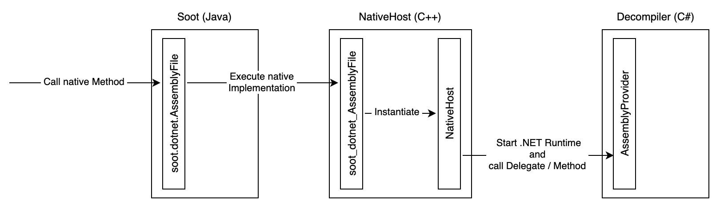

# Soot .NET frontend wrapper
The whole work consists of three parts: The original Soot project (Java), a bridge project which hosts a custom .NET Core runtime (C++) and a managed library which uses APIs of the Open Source decompiler [ILSpy](https://github.com/icsharpcode/ILSpy) (C# on .NET Core). The Protobuf files are stored under Soot.Dotnet.Decompiler.Resources.

### Interaction Overview


## Directory Overview

This directory contains the .NET part of Soot's `soot.dotnet` frontend:

- `Soot.Dotnet.Decompiler` — managed library (C#) on top of the ILSpy decompiler. It answers protobuf requests.
- `Soot.Dotnet.NativeHost` — JNI bridge (C++) that hosts the .NET runtime and forwards calls to the managed library.
- `Soot.Dotnet.TestSnippets` / `Soot.Dotnet.UnitTests` — input assemblies and unit tests directly for the decompiler.
- `Soot.Dotnet.TestConsole` — manual debugging harness.

The Maven build publishes the decompiler, builds the NativeHost and packages everything into Soot's jar under
`soot/dotnet/wrapper`. At runtime Soot extracts the bundled wrapper to a temporary directory, so no wrapper path has
to be configured.

## Requirements

- .NET SDK 8.0 or newer
- A JDK (for the JNI headers)
- A C++17 compiler (`g++` on Linux/macOS, MSVC on Windows)

## Building through Maven

Navigate to the Soot main directory. If you are in the directory of the README, you can navigate using
```cd ../../..```

```sh
mvn package                       # builds Soot and the wrapper
mvn package -DskipDotnet          # builds Soot only
mvn test                          # additionally runs the C# unit tests
mvn package -DskipProtoc          # reuses the checked-in protobuf bindings
mvn package -Pdotnet-wrapper-windows  # additionally cross-compiles the NativeHost for Windows (needs mingw-w64)
```

The wrapper is staged in `target/dotnet/wrapper` and copied to `target/classes/soot/dotnet/wrapper`.

## Building directly

```sh
dotnet publish Soot.Dotnet.Decompiler -c Release -o <wrapper-dir>
JAVA_HOME=/path/to/jdk dotnet build Soot.Dotnet.NativeHost \
    -c Release -p:NativeBinDir=<wrapper-dir>
dotnet test Soot.Dotnet.UnitTests
```

`<wrapper-dir>` must be the same for both commands: the NativeHost loads `Soot.Dotnet.Decompiler.dll` from its own
directory.

## Runtime configuration

Explicit wrapper locations override the bundled one, in this order:

1. `-dotnet-nativehost-path <file-or-directory>`
2. `-Dsoot.dotnet.wrapper.path=<file-or-directory>`
3. `SOOT_DOTNET_WRAPPER=<file-or-directory>`

The bundled wrapper is extracted once per JVM into the system temporary directory unless one of the above is set.

## Regenerating the protobuf bindings

The `.proto` files in `Soot.Dotnet.Decompiler/Resources` are the source of truth. The Maven build regenerates both the
C# bindings (`src/main/generated/protobuf-dotnet`) and the Java bindings
(`src/main/generated/protobuf/soot/dotnet/proto`) with a pinned `protoc` at `generate-sources`, before anything is
compiled. No local `protoc` installation is required. Pass `-DskipProtoc` to reuse the checked-in bindings.

## Deeply nested CIL

Both the decompiler and the protobuf parser recurse once per CIL nesting level, and a managed stack overflow terminates
the process. Therefore the managed decompiler runs on a dedicated 16 MiB thread, the Java parse/conversion runs on a
large-stack thread (due to protbuf's recursion). The environment variable
`DOTNET_EnableAlternateStackCheck` should not be required.

## Generated files

Nothing generated is written next to the sources: protobuf bindings go to `src/main/generated/protobuf-dotnet` and all
MSBuild output (`bin`, `obj`) goes to `src/main/generated/dotnet-build` (see `Directory.Build.props`). Both are removed
by `mvn clean` except the checked-in bindings to ensure it integrates nicely with Soot's build process.

## System tests

`src/systemTest/dotnet` (relative to the Soot main directory) holds the C# targets for the Java system tests in `src/systemTest/java/soot/dotnet`. The Maven
build compiles them into `target/systemTest-dotnet-targets` at `generate-test-resources`; the tests analyze the built
assemblies with the .NET frontend and assert on the generated Jimple. The tests skip themselves when the targets are
missing (`-DskipDotnet` or `-DskipTests`).
